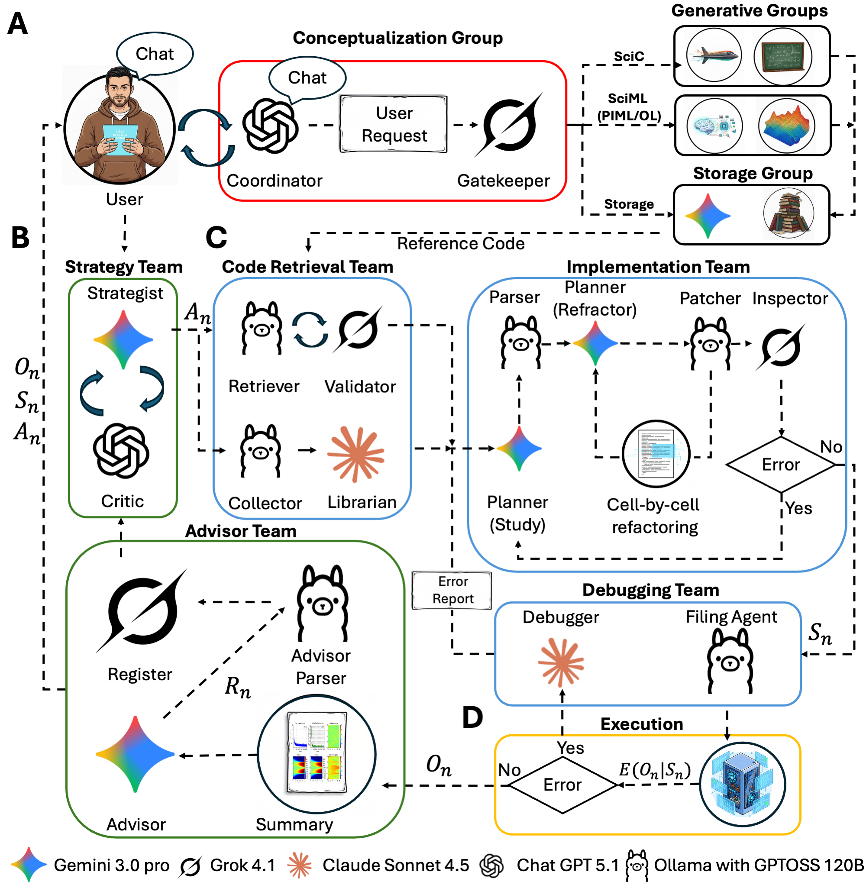

# ATHENA: Agentic Team for Hierarchical Evolutionary Numerical Algorithms



Progress in computational science depends on complex numerical workflows that must faithfully encode physical laws, yet translating conceptual insight into reliable code remains a major bottleneck. Although large language models can generate isolated code fragments, they lack the structured reasoning required to design, verify, and iteratively refine complete scientific pipelines. Here we introduce ATHENA, an agentic framework explicitly designed to emulate scientific research modeled as a knowledge-driven contextual bandit process. Its core loop separates conceptual policy from numerical realization through expert-derived conceptual scaffolding, enabling principled diagnosis, reformulation, and repair of computational strategies. Across scientific computing and scientific machine learning tasks, ATHENA autonomously discovers exact analytical solutions, constructs stable numerical solvers, diagnoses ill-posed formulations, and orchestrates hybrid symbolic–numeric workflows. Quantitatively, ATHENA exceeds expert-designed workflows, achieving superhuman accuracy and robustness on canonical benchmarks. By reframing computation as an object of agentic reasoning, the framework enables autonomous orchestration of heterogeneous algorithms across scientific domains.


# Installation

ATHENA is an agentic framework that orchestrates workflows across three distinct computational environments: **Python (PyTorch)**, **JAX**, and **Julia**.

Please follow the steps below to set up each environment.

> **Tip — let Claude Code do the wiring.** This setup has several pieces that must
> all agree (the two run bridges, `DB_BASE`/`RESULTS_BASE`, the Ollama backend, the
> Chroma DB paths, API keys). The fastest way to get it running on a new machine is to
> hand the whole pre-flight to a coding agent that reads `CLAUDE.md` — see
> [Recommended: drive setup, launch & monitoring with Claude Code](#recommended-drive-setup-launch--monitoring-with-claude-code).

## 1. Primary Environment (Python + PyTorch)
This is the main agentic environment (ATHENA).

1.  **Clone the Repository:**
    ```bash
    git clone [https://github.com/your-username/ATHENA.git](https://github.com/your-username/ATHENA.git)
    cd ATHENA
    ```

2.  **Create and Activate a Virtual Environment:**
    ```bash
    # Using Conda (Recommended)
    conda create -n athena_env python=3.12
    conda activate athena_env
    ```

3.  **Install PyTorch:**
    Install the version of PyTorch compatible with your CUDA version (see [pytorch.org](https://pytorch.org/get-started/locally/)). The pinned environment uses CUDA 12.6.
    ```bash
    # Example for CUDA 12.6
    pip install torch torchvision torchaudio --index-url https://download.pytorch.org/whl/cu126
    ```

4.  **Install ATHENA (Editable Mode):**
    This installs the `crunch_llm` package and its dependencies (LangChain 1.x + LangGraph, on which the agent layer depends).
    ```bash
    pip install -e .
    ```

    For an exact, reproducible environment, install the pinned lockfile instead of (or after) the editable install:
    ```bash
    pip install -r requirements.txt
    pip install -e . --no-deps
    ```
    > **Note:** The agent layer (`crunch_llm/code/agents.py`) is built on the modern `langchain.agents.create_agent` API, which requires **`langchain>=1.0` and `langgraph`**. Older `langchain` 0.3.x installs (which only provide `AgentExecutor`/`create_tool_calling_agent`) will not work.


5.  **Configure API Keys:**
    You must set up your LLM provider keys. A template file is provided in the source code.

    a. Navigate to the code directory:
    ```bash
    cd crunch_llm/code
    ```

    b. Create the `.env` file from the template:
    ```bash
    cp .env_template .env
    ```

    c. Open `.env` and paste your API keys:
    ```bash
    GOOGLE_API_KEY="YOUR_GOOGLE_KEY"
    OPENAI_API_KEY="YOUR_OPENAI_KEY"
    ANTHROPIC_API_KEY="YOUR_ANTHROPIC_KEY"
    XAI_API_KEY="YOUR_XAI_KEY"
    ```
---

## 2. JAX Environment (NABLA-SciML)
The JAX environment handles specific differentiation and optimization tasks using `NABLA-SciML` and `SSBroyden`.

### Setup Instructions (Required for PIML)

1.  **Clone the repository:**
    ```bash
    git clone [https://github.com/jdtoscano94/NABLA-SciML.git](https://github.com/jdtoscano94/NABLA-SciML.git)
    cd NABLA-SciML
    ```

2.  **Create and activate a virtual environment (Recommended):**
    ```bash
    conda create -n nabla_env python=3.10
    conda activate nabla_env
    ```

3.  **Install JAX with GPU support:**
    *(This is required for all modules. We recommend installing it explicitly first to ensure CUDA support)*
    ```bash
    pip install -U "jax[cuda12]"
    ```

4.  **Install the NABLA package:**
    This installs the library in editable mode, which is necessary to import the PIML models.
    ```bash
    pip install -e .
    ```

---

## 3. Julia Environment
High-performance numerical solvers are executed in Julia. You need to create an environment with `Trixi`, `StartUpDG`, `Gridap`, and `NPZ`.

1.  **Install Julia:**
    Download and install Julia from [julialang.org](https://julialang.org/downloads/).

2.  **Setup the Environment:**
    Open the Julia REPL and run the following commands to create a dedicated environment and install the required packages:

    ```julia
    using Pkg

    # 1. Activate a new environment (creates a folder named 'athena_julia_env')
    Pkg.activate("athena_julia_env")

    # 2. Add the required packages
    Pkg.add([
        "Trixi",
        "StartUpDG",
        "Gridap",
        "NPZ"
    ])

    # 3. Precompile dependencies
    Pkg.instantiate()
    ```


## 4. Connecting Environments

To enable ATHENA to control the external solvers, you must configure the bridge scripts to point to your specific installations.

### Julia Connection (`run_julia.sh`)

Navigate to the script located at:
`ATHENA/Documents/Scripts/run_julia.sh`

Open this file and modify the **Configuration** section to match your system paths.

**What to change:**
1.  **`JULIA_EXEC`**: Ensure this finds your `julia` executable (or load your module).
2.  **`PROJECT_ENV`**: Set this to the absolute path of the `athena_julia_env` folder you created in Step 3.

**Example `run_julia.sh` configuration:**

```bash
#!/bin/bash

# --- Configuration ---
# 1. Load your system module (if on HPC) or ensure julia is in PATH
# module load julia/1.12.4s-adme

# 2. Dynamically grab the path to the executable
JULIA_EXEC=$(which julia)

# 3. SET THIS PATH: The location of the Julia environment you created in Step 3
# Example: PROJECT_ENV="/home/username/athena_julia_env"
PROJECT_ENV="/users/your_name/data/athena_julia_env"

# --- Safety ---
set -e
# ... (rest of script) ...
```

### Python / JAX Connection (`run_python.sh`)

Navigate to the script located at:
`ATHENA/Documents/Scripts/run_python.sh`

This is the bridge ATHENA uses for **all Python code** — PINNs, DeepONets, and the JAX/NABLA-SciML (vRBA / SSBroyden) path. Open this file and modify the **Configuration** section so ATHENA can activate the correct Python/JAX environment.

**What to change:**
1.  **`CONDA_ACTIVATION_SCRIPT`**: The path to your system's `conda.sh` file. This is required to activate environments from within a script.
2.  **`CONDA_ENV_NAME`**: The name of the environment you created in Section 2 (e.g., `nabla_env`).

**Example `run_python.sh` configuration:**

```bash
#!/bin/bash

# --- Configuration ---
# 1. Path to your conda activation script (Check your ~/.bashrc or system paths)
# Example: "/gpfs/runtime/opt/anaconda/etc/profile.d/conda.sh"
CONDA_ACTIVATION_SCRIPT="/path/to/your/anaconda3/etc/profile.d/conda.sh"

# 2. Name of the JAX environment created in Section 2
CONDA_ENV_NAME="nabla_env"

# --- Safety ---
set -e

# ... (rest of script) ...
# The script will verify the paths, activate the environment, and execute the Python code.
```

# Configuring the Models

Every agent in ATHENA is provider-agnostic: it is created with a `model` name and a
`model_provider` string, and the framework dispatches to the right SDK. You change which
LLM an agent uses simply by editing those two arguments.

**Supported providers** (the `model_provider` value): `google`, `openai`, `anthropic`
(alias `claude`), `xai` (alias `grok`), and `ollama` (local). Each provider reads its key
from `crunch_llm/code/.env` (`GOOGLE_API_KEY`, `OPENAI_API_KEY`, `ANTHROPIC_API_KEY`,
`XAI_API_KEY`); `ollama` needs a local Ollama server instead of a key.

**Changing an agent's model.** Anywhere an agent is constructed (in a notebook or script),
set the two arguments:

```python
agent = StructuredAgent(
    model='gemini-3-flash-preview',   # any model id valid for the provider
    model_provider='google',          # google | openai | anthropic | grok | ollama
    system_prompt=...,
)
```

To switch the same agent to Grok or OpenAI, change only those two fields:

```python
# Grok
StructuredAgent(model='grok-4-1-fast-reasoning', model_provider='grok',  ...)
# OpenAI
StructuredAgent(model='gpt-5.1',                 model_provider='openai', ...)
```

**Two kinds of models to keep in mind.**
1. **Generation models** — the LLMs the agents reason with (analyzer, strategist, advisor, …).
2. **Embedding models** — used to build and query the vector database. These are set with
   `provider` / `model_name` in `initialize_local_data(...)` and with
   `embeddings_provider` / `embeddings_model` in the retriever agents.

> **Important — embeddings must match.** The embedding model used to **ingest** a collection
> must be the same one used to **query** it (different models produce different,
> incompatible vector dimensions). If you change the embedding model, re-ingest the
> affected databases.

The defaults shipped in `crunch_llm/code/HENA.py` (the `build_agents_*` factories) are:

| Role | Default | Provider |
|---|---|---|
| Generation agents (strategist, retriever, planner, patcher, inspector, debugger, advisor, …) | `gpt-oss:120b` | `ollama` (local) |
| Embeddings | `models/gemini-embedding-001` (3072-dim) | `google` |

So **a running Ollama server is required** for the default configuration (only the embeddings
run on a cloud API). Start it **before any run**:

```bash
module load ollama          # on HPC clusters that provide it (e.g. Oscar / Brown); skip elsewhere
ollama serve &              # start the server; leave it running (listens on 127.0.0.1:11434)
ollama pull gpt-oss:120b    # one-time: fetch the model the default agents use
ollama list                 # verify the server responds and the model is present
```

> **No local GPU?** `gpt-oss:120b` needs a GPU-backed Ollama server, but you don't have to use
> it — the agents are provider-agnostic, so this is an easy swap. Point the generation agents at
> **any provider** — Gemini (`model='gemini-3-flash-preview'`, `model_provider='google'`),
> ChatGPT/OpenAI (`model_provider='openai'`), Anthropic (`'claude'`), or Grok (`'grok'`) — by
> editing `model` / `model_provider` in the `build_agents_*` factories in `HENA.py`. The
> embeddings already run on a cloud API, so an all-cloud setup needs no GPU and no Ollama at all.


# Preparing the Run Scripts (pre-flight)

ATHENA does not execute generated code in-process — it shells out to two bridge
scripts that activate your environments and run the code. **Before running the
Tutorial, update these two scripts to match your machine.** If you cloned this repo
you already have them; you just need to edit the paths.

Both live in `Documents/Scripts/`:

| Script | Used for | Fields to set |
|---|---|---|
| `run_python.sh` | All Python: PINNs (**B**), DeepONets (**C**), JAX/NABLA-SciML | `CONDA_ACTIVATION_SCRIPT` (your `conda.sh`), `CONDA_ENV_NAME` (your JAX/PINN env) |
| `run_julia.sh` | Julia numerical solvers (**A**, SciC) | `JULIA_EXEC` (your `julia` binary), `PROJECT_ENV` (your Julia project dir) |

```bash
# Documents/Scripts/run_python.sh
CONDA_ACTIVATION_SCRIPT="/path/to/anaconda3/etc/profile.d/conda.sh"
CONDA_ENV_NAME="NABLA_JAX"          # the env from Installation Section 2

# Documents/Scripts/run_julia.sh
JULIA_EXEC="/path/to/.juliaup/bin/julia"   # or $(which julia)
PROJECT_ENV="/path/to/Learning_Julia"      # the project from Installation Section 3
```

> **Note:** you no longer need to edit any absolute path inside `crunch_llm/code/utils.py`.
> `run_code()` now resolves both scripts **relative to the repo** (`<repo>/Documents/Scripts/`),
> so only the two script bodies above are machine-specific.

**Verify the bridges before launching a run.** Drop a one-line script in each language
and execute it through `run_code()`; both should exit cleanly and write a `.out` log:

```python
import os
import crunch_llm.code.utils as U

d = os.path.abspath("scratch/bridge_test"); os.makedirs(d, exist_ok=True)
open(f"{d}/toy.py", "w").write("import jax; print('python OK', jax.devices())")
open(f"{d}/toy.jl", "w").write('println("julia OK")')

for fn in ("toy.py", "toy.jl"):
    ok, log = U.run_code(d, fn, f"{d}/{fn}")
    print(fn, "->", ok); print(open(log).read())
```

A healthy result prints `python OK [CudaDevice(id=0)]` and `julia OK` with empty
`.err` files. If a run fails to launch, this is the first place to look (it is the
most common setup issue — see the path table above).


## Recommended: drive setup, launch & monitoring with Claude Code

This repo ships a `CLAUDE.md` that gives [Claude Code](https://claude.com/claude-code)
(or any coding agent) full project context. The numerical core is deterministic and works
as-is, but **getting it running on a new machine means making several moving parts agree at
once** — the two run bridges (`run_python.sh`, `run_julia.sh`), `DB_BASE`/`RESULTS_BASE` in
`HENA.py`, the four Chroma DB paths/collections, the Ollama backend for the local agents, and
the API keys in `crunch_llm/code/.env`. Any one of these silently mismatched fails deep inside
the HENA loop, not at startup. An agent that reads `CLAUDE.md` is the fastest way through this:
it can point the bridges at your conda env / Julia project, line up the DB and Results paths,
start Ollama, launch `run_athena.py`, tail the per-run logs, and surface crashes in real time.
This is the manual, machine-specific friction, so the agent is where it earns its keep —
**operational reproducibility** (getting it running on a new machine).

> **Scope:** the agent is a convenience for setup and running — **not** the experiment runner.
> Scientific reproducibility comes from the deterministic core: the pinned
> `Conceptualization_team/ATHENA_Request_*.json` specs, `run_athena.py`, and the logged
> transcripts under `crunch_llm/code/HENA_logs/`. Treat the agent as the driver of those
> artifacts, not a substitute for them — results are reproduced from the scripts and logs,
> not from any ad-hoc decisions the agent makes mid-run.


# Tutorial

The workflow has three stages: **(1) Ingestion** builds the reference-code knowledge bases,
**(2) Conceptualization** formalizes a problem, and **(3) Evaluation** runs the HENA loop.

## Step 1 — Ingestion

Ingestion reads the curated reference code under `Documents/codes/` and indexes it into
local [Chroma](https://www.trychroma.com/) vector databases. At run time the agents retrieve
from these databases to ground their solutions in working examples.

> **Verify every reference file runs on _your_ stack before ingesting it.**
> The agents ground each solution in the retrieved templates, so a template that
> is broken on your machine propagates that breakage into every generated
> solution — and the failure surfaces deep in the HENA loop (or as a silently
> wrong plot), not at ingestion time.
>
> This matters **especially for Julia**, where package APIs drift across versions.
> Run each `Documents/codes/Numerical_Methods/Scripts/*.jl` through your
> `Documents/Scripts/run_julia.sh` bridge — with **your** Julia version, **your**
> `--project` environment, and the **thread count you will actually use** — and
> confirm it exits cleanly *and* produces a correct `summary_all.png` before
> ingesting. (Trixi.jl is a common offender: kernels can throw
> `UndefRefError`/`TaskFailedException` under `--threads > 1`, and plotting calls
> change between releases.) Apply the same check to the Python/JAX templates in
> your `NABLA-SciML` environment. Re-run `--clear` ingestion after fixing a
> template so the corrected version replaces the stale one.

### What gets generated

A single script, `Ingestion/ingest.py`, builds **four knowledge bases** — one per `--class`:

| `--class` | Source files | DB path | Chroma collection |
|---|---|---|---|
| `numerical_methods` | `Documents/codes/Numerical_Methods/Scripts/` (Julia/Python solvers) | `Documents/database_NM` | `Numerical_Methods_opt` |
| `pinns` | `Documents/codes/SciML/PINNs/` | `Documents/database_PIML` | `PINNs_Codes` |
| `deeponet` | `Documents/codes/SciML/Modules/layers.py` (network layers) | `Documents/database_Modules_ollama` | `Layers` |
| `operators` | `Documents/codes/SciML/Operator_Learning/DeepONets/Files/` | `Documents/database_Operators` | `Operators` |

For each source file the script: runs an **analyzer LLM** to extract structured metadata
(method, equation, dimensionality, optimizer, BCs, …), splits the code into cells/chunks,
prepends an analysis header, embeds each chunk, and writes it to the collection. A per-class
report is saved to `Ingestion/ingest_report_<class>.json`.

### How to run it

From the repository root, with `athena_env` active and your `GOOGLE_API_KEY` set:

```bash
# Build each knowledge base
python Ingestion/ingest.py --class numerical_methods
python Ingestion/ingest.py --class pinns
python Ingestion/ingest.py --class deeponet
python Ingestion/ingest.py --class operators
```

This uses the cloud-API defaults (analyzer `gemini-3-flash-preview`, embeddings
`models/gemini-embedding-001`) — no Ollama needed.

**Useful flags:**

```bash
python Ingestion/ingest.py --class pinns \
    --model gemini-3-flash-preview \      # analyzer LLM
    --provider google \                   # analyzer provider
    --embed-provider google \             # embeddings provider (google | openai | ollama)
    --embed-model models/gemini-embedding-001 \
    --path Documents/codes/SciML/PINNs \  # override the source dir/file
    --db-path Documents/database_PIML \   # override the DB location
    --collection PINNs_Codes \            # override the collection name
    --clear                               # wipe the collection before ingesting
```

> **Re-ingesting:** a second run **appends** to the collection. Pass `--clear` to rebuild
> cleanly, or `--clear-only` to just empty a collection. If you change the **embedding
> model**, delete the DB directory first (vector dimension is fixed at creation).

**Verifying:** each run prints `✅ Ingested: <file> (N chunks)`. You can also inspect a
collection directly:

```python
import chromadb
c = chromadb.PersistentClient(path="Documents/database_NM").get_collection("Numerical_Methods_opt")
print(c.count(), "chunks")
```

### Adding your own knowledge

To index additional code (new PINN architectures, solvers, operator variants), drop the
files into the relevant `Documents/codes/...` folder and re-run the matching `--class`
(use `--path` to point at a different directory). For best retrieval, organize code into
**distinct, well-commented cells** with clear docstrings — the analyzer and the cell
splitter rely on that structure.

## Step 2 — Setting up New Problems (Running the Conceptualization Team)

To set up a new scientific problem through an interactive dialogue with ATHENA, run the formalization script:

```bash
python Conceptualization_team/Formalize.py
```

This script initiates a conversational agent that will guide you through defining your problem statement.
* **Process:** A *Coordinator* agent interviews you about the physics, constraints, and objectives, proposes a hybrid strategy (e.g. *infer with a PINN, then verify numerically*), and writes a formal specification. A *Gatekeeper* agent then routes that specification into an ordered execution pipeline.
* **Output:** A **JSON file** `ATHENA_Request_<problem_name>.json`, containing the standardized `problem_name`, an ordered `pipeline` of stages (each tagged `A` = SciC, `B` = PINN, `C` = Operator), a `description`, and the full formalized spec under `user_request`.
* **Transcript:** The whole conversation is mirrored to `Conceptualization_team/Formalization_logs/formalization_<timestamp>.txt` for auditing.
* **Usage:** This JSON is formatted and ready to be fed directly into `run_athena.py` (Step 3, autonomous mode).

**Non-interactive (batch) mode.** If you already have a complete problem description in a text file, you can skip the chat and generate the JSON in one shot:

```bash
python Conceptualization_team/Formalize.py --request-file my_problem.txt
```

### (Optional) Skipping the Conceptualization Team

The Conceptualization Team is a **convenience layer** — its only job is to turn a loosely-worded idea into a complete, well-posed specification. **It is entirely optional.** If you already know your problem precisely, you can bypass it and drive the evaluation directly: hand-author a request JSON (copy any `Conceptualization_team/ATHENA_Request_*.json` as a template) with your `pipeline` and a self-contained `user_request`, then run it with `python run_athena.py <your.json>`. The `user_request` string is fed verbatim to the HENA loop as the problem spec.

For the loop to succeed without the Coordinator's help, just make sure your `user_question` is **self-contained**. Include:

* **Governing equation(s)** — the PDE/ODE in explicit form.
* **Domain** — spatial (and temporal, if transient) extent.
* **Boundary conditions** and, for time-dependent problems, **initial conditions**.
* **Physics parameters** — all constants (e.g. `Re`, `ν`, `ϵ`), or which ones are *unknown* for an inverse problem.
* **Data** — path and format of any reference/observation data, plus how to sample it (e.g. number of sensors, noise level).
* **Targets, validation, and outputs** — what to infer, which error metrics to report, and the expected figure/file names.

In short: the Conceptualization Team *produces* this specification, but if you can write it yourself, you can feed the equation directly. The interactive step exists to help when the problem is still vague — not as a required gate.

## Step 3 — Evaluation

There are **two ways to run a problem**, suited to different situations:

* **Autonomous mode — `run_athena.py`.** Reads a request JSON and runs every
  pipeline stage end-to-end through the HENA loop, hands-off. This is the path for a
  **new problem**: first let the **Conceptualization Team** frame it properly
  (`Formalize.py`, Step 2) into a request JSON — highly encouraged, since it scopes
  the physics, picks the family (A/B/C), and writes a clean request — then run it.

  ```bash
  python run_athena.py Conceptualization_team/ATHENA_Request_Rayleigh_Taylor_2D_Euler.json
  ```

* **Interactive mode — the example notebooks.** When you **already understand the
  problem** and don't need the Conceptualization Team to contextualize it, it is
  easier to run the per-problem notebook in `Examples_<family>/` directly. Each runs
  **only the HENA loop**, seeded with your `user_question`, and is the preferred path
  for human-in-the-loop work and checkpoint-driven runs. See
  [**Interactive mode (the example notebooks)**](#interactive-mode-running-the-hena-loop-directly-the-example-notebooks)
  below.

### Reference data

Most examples are self-contained (they generate their own reference). Three
data-driven examples load an external file from `Documents/codes/Data/`:

| Example | File | Size | Where it comes from |
|---|---|---|---|
| `Allen_Cahn_PINN` | `allen_cahn.mat` | 1.8 MB | included in the repo |
| `Inverse_2D_NavierStokes_…_ReInference` | `ldc_Re500.npz` | 3.0 MB | included in the repo |
| `Viscous_Burgers_DeepONet` | `Burger_1000_5000.mat` | 374 MB | **download from [Google Drive](https://drive.google.com/file/d/1Tr6a22SiMpgUlzbIHiBFAt8DRGXQ30E6/view)** into `Documents/codes/Data/` (too large for git) |

The request JSONs reference these by absolute path under
`Documents/codes/Data/`; adjust if you relocate the repo.

### How `run_athena.py` works

`run_athena.py` reads a request JSON and runs **every stage in its `pipeline`,
in order**, dispatching each stage to the HENA loop for its family
(`A`=SciC/Julia, `B`=PINN/JAX, `C`=Operator). You do not edit any code to run a
case — you point the script at the JSON:

```bash
python run_athena.py Conceptualization_team/ATHENA_Request_<name>.json
```

Optional flags:

| Flag | Effect |
|------|--------|
| `--runs N`    | Repeat the whole pipeline `N` times (for regret / variance analysis). |
| `--max-iters N` | Cap the HENA loop at `N` iterations per stage (quick smoke test). |
| `--stage N`   | Run **only** pipeline stage `N` (essential for multi-stage cases — see below). |

Each run writes:
* generated code, data, and per-iteration reports → `Results/<FAMILY>_codes/<ProjectName>/<timestamp>/`
* the full multi-agent transcript → `Examples_<family>/<ProblemName>_log.txt`, mirroring the
  notebook convention: **A → `Examples_NM`**, **B → `Examples_PINNs`**, **C → `Examples_DeepONet`**.

> **Family-A analytical cases.** Family A covers both numerical-validation problems
> (`Examples_NM`) and analytical-exact ones (`Examples_analytical_exact`), so its logs default to
> `Examples_NM`. If the problem is analytical-exact (e.g. `Viscous_Burgers_1D_Analytical`,
> `Inviscid_Burgers_2D`, `BlackScholes_1D`, `Wave_Equation_3D_Spherical`), move the
> resulting `<ProblemName>_log.txt` into `Examples_analytical_exact/` afterwards.

(Passing an explicit `log_base=` to `run_hena` restores the old
`crunch_llm/code/HENA_logs/<FAMILY>/hena_<family>_<name>_<timestamp>.txt` layout instead.)

`APPROVED` from the advisor ends a stage; the project directory and log path are printed at the end.

### Single-stage cases (most problems) — one command

For every single-stage case, just run its JSON. Family `A` runs Julia, `B`/`C` run Python/JAX.

| Case (run `python run_athena.py Conceptualization_team/ATHENA_Request_<file>.json`) | Family | Extra data |
|---|---|---|
| `Rayleigh_Taylor_2D_Euler` | A | — |
| `Rayleigh_Taylor_2D_NavierStokes` | A | — |
| `Kelvin_Helmholtz_2D_Euler` | A | — |
| `Inviscid_Burgers_2D` | A | — |
| `Viscous_Burgers_1D_Analytical` | A | — |
| `Viscous_Burgers_1D_Numerical` | A | — |
| `Anisotropic_Diffusion_2D` | A | — |
| `BlackScholes_1D` | A | — |
| `Cahn_Hilliard` | A | — |
| `Wave_Equation_3D_Spherical` | A | — |
| `Helmholtz_PINN` | B | — |
| `Poisson_PINN` | B | — |
| `KdV_PINN` | B | — |
| `Inviscid_Burgers_PINN` | B | — |
| `Allen_Cahn_PINN` | B | `allen_cahn.mat` (in repo) |
| `Viscous_Burgers_DeepONet` | C | `Burger_1000_5000.mat` (download — see *Reference data*) |

Example:

```bash
python run_athena.py Conceptualization_team/ATHENA_Request_Helmholtz_PINN.json
```

### Multi-stage cases (when there are many steps)

Two cases chain families. `run_athena.py` will execute their stages in order from
a single command, **but a later stage that consumes an earlier stage's output
needs that output's path** — and the JSON ships with the path from the paper's
original run, which won't match your fresh timestamped `Results/` folder. So for
multi-stage cases run **stage by stage** and wire the path through:

**`Inverse_2D_NavierStokes_LidDrivenCavity_ReInference` — Stage 1 (B, PINN) → Stage 2 (A, numerical)**

This is the inverse Navier–Stokes case: Stage 1 trains an inverse PINN on the
lid-driven-cavity data (`ldc_Re500.npz`, in repo) to infer the Reynolds number
and the hidden v-field; Stage 2 runs a high-fidelity forward Julia solve at the
inferred `Re` and validates against the same ground truth.

```bash
# 1) Run Stage 1 (the inverse PINN). Note the printed project_dir.
python run_athena.py \
  Conceptualization_team/ATHENA_Request_Inverse_2D_NavierStokes_LidDrivenCavity_ReInference.json \
  --stage 1
#    -> produces Results/PINN_codes/Inverse_NavierStokes_.../<timestamp>/results.npz

# 2) Edit the JSON: in the "### STAGE 2" section, set the Stage-1 output path
#    ("path:" under "The data was saved as:") to that results.npz from step 1.

# 3) Run Stage 2 (the forward Julia verification at the inferred Re).
python run_athena.py \
  Conceptualization_team/ATHENA_Request_Inverse_2D_NavierStokes_LidDrivenCavity_ReInference.json \
  --stage 2
```

> Running the JSON without `--stage` executes Stage 1 then Stage 2 back-to-back,
> but Stage 2 will read whatever Stage-1 output path is currently written in the
> JSON — so do one full run first (or pre-set the path) before relying on the
> straight-through form.

**`1D_Viscous_Burgers_PINN` — Stage 1 (A) → Stage 2 (B) → Stage 3 (B)**

Generate a high-fidelity numerical reference (A), then train a PINN against it
(B), then evaluate (B). This spec feeds the full description to each stage, so a
straight `python run_athena.py …ATHENA_Request_1D_Viscous_Burgers_PINN.json`
runs all three; if you want the PINN stages to read the exact Stage-1 reference
file, run `--stage 1` first and point the PINN stages at its `Results/` output.

### Interactive mode: running the HENA loop directly (the example notebooks)

Every example also ships as a self-contained notebook in its `Examples_<family>/`
folder (e.g. `Examples_PINNs/Poisson.ipynb`, `Examples_NM/Cahn-Hilliard_Equation.ipynb`).
Unlike `run_athena.py`, a notebook runs **only the HENA loop** — it skips the
Conceptualization Team and is seeded directly with a `user_question`. The whole
notebook is just a handful of cells: imports → paths → agent setup →
`user_question` → run the loop → (optional) refinement.

**When to use this instead of `run_athena.py`.** For a **new problem**, prefer the
autonomous path and let the Conceptualization Team frame it first — this is highly
encouraged, as it scopes the physics and routes the problem properly. But when you
**already understand the problem** and don't need it contextualized, editing a
notebook's `user_question` and running the loop directly is faster and gives a
cell-by-cell view of the run.

**Human-in-the-loop demos.** A few cases are kept specifically because they benefit
from a human in the loop, and the notebooks make that hand-off explicit:

* **Multi-step orchestration (PINN → numerical) — two notebooks.** The inverse
  lid-driven-cavity case is split across a PINN notebook and a numerical notebook,
  in the order the agents themselves prescribe:
  1. `Examples_PINNs/Lid_driven_500_inverse.ipynb` — the inverse PINN infers the
     Reynolds number (`Re ≈ 525`) and the hidden velocity field from sparse, noisy
     data, and saves `results.npz`.
  2. `Examples_NM/Validation_NS.ipynb` — a high-fidelity numerical solve at the
     inferred `Re` verifies the physics against the true `Re = 500`. You carry
     Step 1's output forward by setting `PINN_parameter` (the inferred `Re`) and
     `path_data` to Step 1's `results.npz`.

* **Failure + a one-sentence human hint.** When the autonomous run stalls, a single
  sentence in the request rescues it (the agents interpret and integrate the hint):
  * `Examples_analytical_exact/VB1D.ipynb` (Viscous Burgers) — the agents find the
    Cole–Hopf transformation but the integral fails under standard quadrature; the
    request carries the hint *"use Gauss–Hermite quadrature,"* which resolves it to
    machine precision.
  * `Examples_PINNs/Inviscid_burgers_Human_Wavelet.ipynb` (Inviscid Burgers) —
    periodic Fourier embeddings oscillate near the shock; a hint to use periodic
    wavelet embeddings with a refined viscosity schedule extends shock capturing to
    lower viscosity.

**Easy checkpointing.** The notebooks expose checkpointing as a single editable
cell — set `checkpoint_project_dir` to a prior `Results/<run>/` folder and load it
with `load_checkpoint_data(checkpoint_project_dir, load_code_only=...)`:

* `load_code_only=True` — restart from a previously **successful script** only
  (e.g. `Lid_driven_500_inverse.ipynb`).
* `load_code_only=False` — restore the **full prior state**: strategy, history, and
  error report (e.g. `Inviscid_burgers_Human_Wavelet.ipynb`, resuming a human-guided
  run).

Leave `checkpoint_project_dir=''` to start fresh.

**Provenance.** Most of the paper's results were produced in this interactive
notebook mode — including the **ablation studies** (`Examples_*/Ablation_Study/`)
and the **regret analyses** (`Examples_NM/Regret_analysis/`,
`Examples_analytical_exact/Regret_analysis/`, `Examples_PINNs/Regret_Analysis_HM/`).
Each notebook pins the **exact LLM versions used for that result** in its agent-setup
cell (e.g. `gemini-3-pro-preview`, `gpt-5.1`, `claude-sonnet-4-5`,
`grok-4-1-fast-reasoning`, with `gpt-oss:120b` and Google `text-embedding-004` for
retrieval), so each figure can be traced to the specific models that generated it.

> The notebooks ship with the authors' absolute paths (the `my_database_path…`,
> `base_results_dir`, and `checkpoint_project_dir` cells point at
> `/users/jdtoscan/.../Crunch_LLM/...`). Edit those to your own vector-DB and
> `Results/` locations before running.

### Resuming from a checkpoint

Any run can be resumed from a prior `Results/` folder via `run_hena` (which
`run_athena.py` wraps):

```python
from crunch_llm.code.HENA import run_hena

# Continue a prior run (restore strategy, history, error report):
run_hena("A", user_question, checkpoint_project_dir="Results/NM_codes/<Project>/<timestamp>",
         load_code_only=False)

# Or start fresh from a previously-successful script only:
run_hena("A", user_question, checkpoint_project_dir="Results/NM_codes/<Project>/<timestamp>",
         load_code_only=True)
```

### Reproducing the paper figures

The figures in the paper are assembled by the four notebooks in `Plots/`
(`Analytical.ipynb`, `NM.ipynb`, `PINNs.ipynb`, `Regret_analysis.ipynb`). They
read precomputed result arrays from the per-run folders under
`Results/<FAMILY>_codes/<Project>/<timestamp>/` using **repo-relative paths**
(`../Results/...`), so they work wherever the repo is cloned.

The data each notebook reads is committed under `Results/`, so the figures
reproduce directly from a clone — just run the notebooks. For the large
time-resolved solves (the compressible Euler / Navier–Stokes / Kelvin–Helmholtz
runs, and the 2-D diffusion field) only the time slices the figures actually
display are stored, which keeps each file small; the colorbars are computed from
those same slices. The DeepONet plot file keeps the test set and training
diagnostics it plots, dropping the unused training trajectories.

The generated script (`.jl`/`.py`) that produced each run folder is also tracked,
so you can regenerate any result from scratch instead of using the stored data:

```bash
# Julia (family A) — writes its .npz back into the same folder (uses @__DIR__)
Documents/Scripts/run_julia.sh  Results/NM_codes/<Project>/<timestamp>/<script>.jl

# Python / PINN (families B, C) — run FROM the folder so np.savez lands there
cd Results/PINN_codes/<Project>/<timestamp> && \
  /path/to/Documents/Scripts/run_python.sh <script>.py
```

Julia solves are deterministic; the PINN/operator scripts carry a fixed seed
(`--SEED 9999`), so reruns reproduce the figures up to library/floating-point
nondeterminism.

### A Note on GPU Requirements

The shipped defaults in `HENA.py` run most agents on the local model `gpt-oss:120b` (via an
Ollama server with significant VRAM requirements), so the default configuration **needs a local
GPU + Ollama**. The system is equally functional through cloud APIs, though — point any agent at
a cloud provider and you need **no local GPU**. See
[**Configuring the Models**](#configuring-the-models) for how to change the `model` /
`model_provider` of any agent (for example, Gemini on `google`, ChatGPT on `openai`, or
`grok-4-1-fast-reasoning` on `grok`).

### A Note on Auditing the Agent Interaction
Auditing the full, multi-turn interaction between the agents (Strategist, Advisor,
Critic, etc.) matters as much as the final solution. Every run mirrors its entire
multi-agent transcript to `Examples_<family>/<ProblemName>_log.txt` (A → `Examples_NM`,
B → `Examples_PINNs`, C → `Examples_DeepONet`), so the complete reasoning trace is preserved as a
plain-text record kept right next to each example notebook — the same place the notebooks
themselves store their captured transcripts.

### Citation

If you use ATHENA in your research or find this framework helpful, please cite our preprint:

```bibtex
@article{toscano2025athena,
  title={ATHENA: Agentic Team for Hierarchical Evolutionary Numerical Algorithms},
  author={Toscano, Juan Diego and Chen, Daniel T and Karniadakis, George Em},
  journal={arXiv preprint arXiv:2512.03476},
  year={2025}
}
```

**Please also cite the libraries ATHENA builds on.** The physics-informed / operator-learning
(families **B** and **C**) path uses **NABLA-SciML** (the variational residual-based-adaptivity
framework where vRBA / SSBroyden was introduced), and the numerical-methods (family **A**) path
runs its solvers in **Julia**:

```bibtex
@article{toscano2025variational,
  title={A variational framework for residual-based adaptivity in neural PDE solvers and operator learning},
  author={Toscano, Juan Diego and Chen, Daniel T and Ooomen, Vivek and Darbon, J{\'e}r{\^o}me and Karniadakis, George Em},
  journal={npj Artificial Intelligence},
  volume={2},
  number={1},
  pages={32},
  year={2026},
  publisher={Nature Publishing Group UK London}
}

@article{bezanson2017julia,
  title={Julia: A fresh approach to numerical computing},
  author={Bezanson, Jeff and Edelman, Alan and Karpinski, Stefan and Shah, Viral B},
  journal={SIAM review},
  volume={59},
  number={1},
  pages={65--98},
  year={2017},
  publisher={SIAM},
  url={https://doi.org/10.1137/141000671}
}
```

## A Note on Model Availability (deprecated model IDs)

The example notebooks and the `build_agents_*` factories in `HENA.py` pin the **exact
LLM versions used to produce the paper's results** (e.g. `gemini-3-pro-preview`,
`gpt-5.1`, `claude-sonnet-4-5`, `grok-4-1-fast-reasoning`, with `gpt-oss:120b` and
Google `text-embedding-004` for retrieval). These pins are deliberate — they are the
provenance record of which models generated each figure.

However, **LLM providers periodically retire model IDs**, especially *preview*
versions. A retired model surfaces as a run-time error such as:

```
NOT_FOUND: 404 ... This model models/gemini-3-pro-preview is no longer available.
Please update your code to use a newer model ...
```

If you hit an error like this (`NOT_FOUND` / `model not found` / `404` / `model is no
longer available`), the model ID simply needs to be **swapped for a current
equivalent from the same provider**. Edit the `model=` argument wherever that agent is
constructed:

* **In a notebook** — the agent-setup cell (Strategy / Retrieval / Advisor teams).
* **For `run_athena.py`** — the matching `build_agents_*` factory in
  `crunch_llm/code/HENA.py`.

For example, replace a retired `model='gemini-3-pro-preview'` with the latest
available Gemini (e.g. `model='gemini-2.5-pro'`, or whichever is current). The agents
are provider-agnostic, so only the `model` / `model_provider` strings change — see
[**Configuring the Models**](#configuring-the-models). Swapping a model may slightly
change the generated solution (different models reason differently), but the HENA loop
and the framework behave identically.
